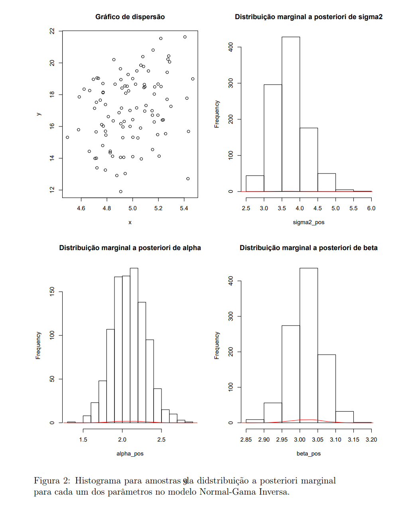

# Bayesian Inference in R

From-scratch implementations of core Bayesian computation methods (MCMC sampling and conjugate posteriors), written for **SME0809 Bayesian Inference** at the Universidade de São Paulo.


## Contents

| Script | Method | What it shows |
|---|---|---|
| [`metropolis_hastings.R`](metropolis_hastings.R) | Metropolis–Hastings | A hand-written sampler for a target distribution, with burn-in, thinning, acceptance rate and convergence checks (trace plots, `coda`) |
| [`gibbs_sampler_regression.R`](gibbs_sampler_regression.R) | Gibbs sampling | Bayesian simple linear regression: draws α, β and σ² by alternating between their full conditional distributions |
| [`conjugate_posteriors.R`](conjugate_posteriors.R) | Conjugate analysis | **Dirichlet–Multinomial** posterior for category proportions and **Normal–Inverse-Gamma** posterior for regression parameters, sampled directly with no MCMC needed |

Comments in the scripts are in Portuguese.

## Example output

Posterior marginals for a simulated regression (true values α = 2, β = 3, σ² = 5) under a Normal–Inverse-Gamma prior. The posterior for β concentrates tightly around 3.

<p align="center"></p>

## Running

```r
install.packages(c("coda", "MCMCpack"))
source("gibbs_sampler_regression.R")
```

## Skills practiced

- Deriving full conditional and posterior distributions by hand, then checking them by simulation
- Building MCMC samplers from scratch and diagnosing convergence (burn-in, thinning, trace plots, acceptance rate)
- Choosing priors and reading how they shape the posterior
