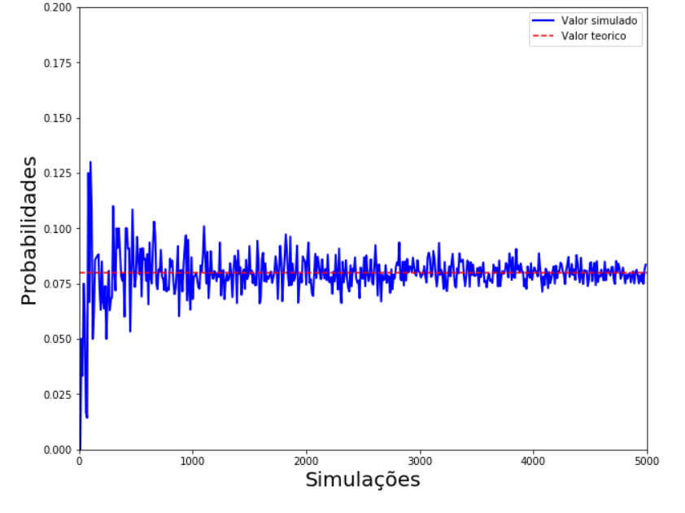

# Markov Chains & PageRank: Stochastic Processes in Python

Analytical solutions checked against Monte Carlo simulation for classic Markov chain problems, ending with a **PageRank implementation from scratch** on the *Les Misérables* character network. Written for **SME0805 Stochastic Processes** at the Universidade de São Paulo.


## What's inside

| # | Problem | Technique |
|---|---|---|
| 1 | A fly moves randomly around a room: what's the chance it escapes through the window before the spider catches it, and how long does it take? | Absorbing Markov chains: first-step analysis, absorption probabilities and expected time to absorption, solved as linear systems |
| 2 | Gambler's ruin with p = 0.49, then three players betting against each other | Closed-form ruin probability plus simulation for varying odds and starting wealth |
| 3 | Expected number of coin tosses until a pattern appears | Transition matrix and expected hitting times, simulated for several values of p |
| 4 | Random walk on a small weighted graph | Stationary distribution via eigenvectors, checked with 1k and 1M-step simulations |
| 5 | **PageRank** on the *Les Misérables* co-appearance network (77 characters) | Transition matrix, Google matrix with damping α = 0.85, stationary vector via eigendecomposition, validated against a 10,000-step random walk |

For every problem, the theoretical value is compared with a simulation, and convergence is plotted as the number of experiments grows.

<p align="center"></p>

## Files

- [`markov_chains_pagerank.ipynb`](markov_chains_pagerank.ipynb): the notebook with outputs and plots
- [`markov_chains_pagerank.py`](markov_chains_pagerank.py): the same code as a plain script

Explanations in the notebook are in Portuguese.

## Running

```bash
pip install numpy scipy matplotlib "networkx<3"
jupyter notebook markov_chains_pagerank.ipynb
```

(`networkx<3` because the notebook uses `to_numpy_matrix`, which NetworkX 3 removed.)

Exercise 5 expects `lesmis.gml` (the Les Misérables network from Knuth's Stanford GraphBase) in the same folder.

## Team

Group project with Andrey Inácio Paulino and Gabriel Victor de Jesus Lima.
